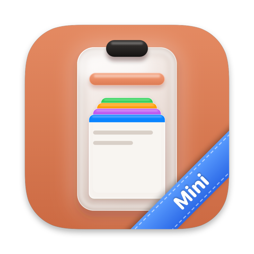
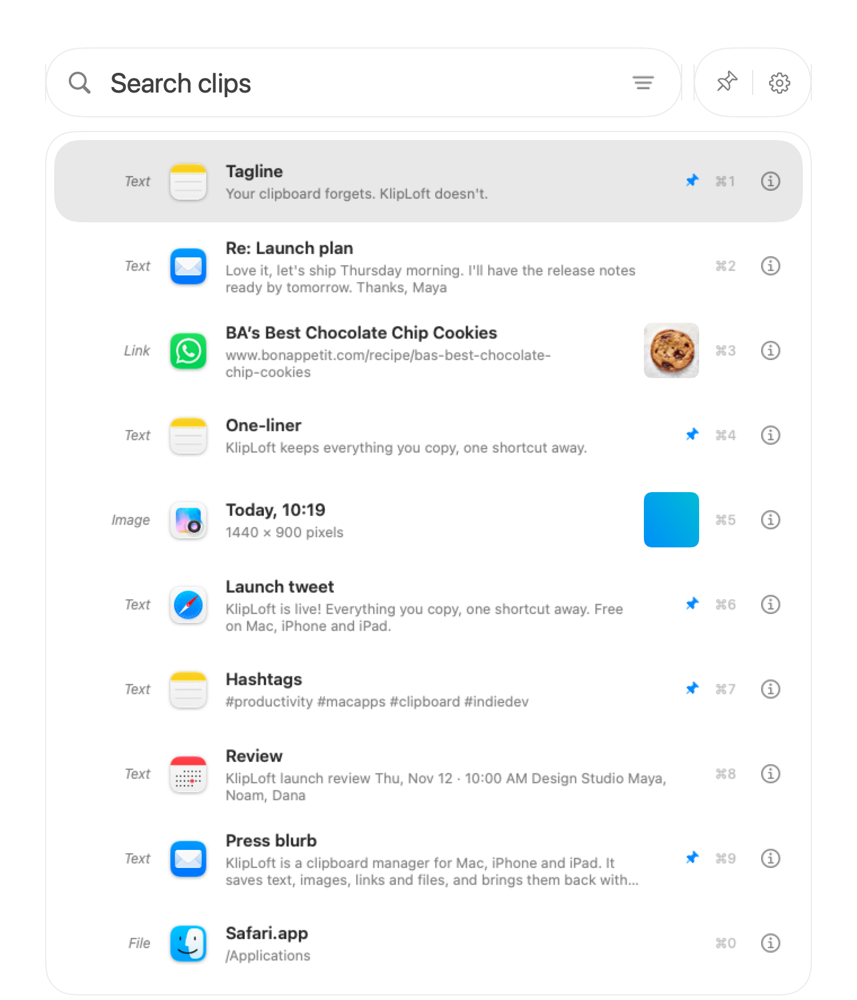
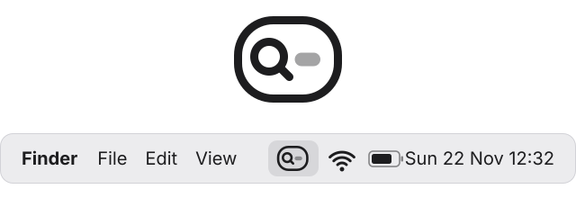
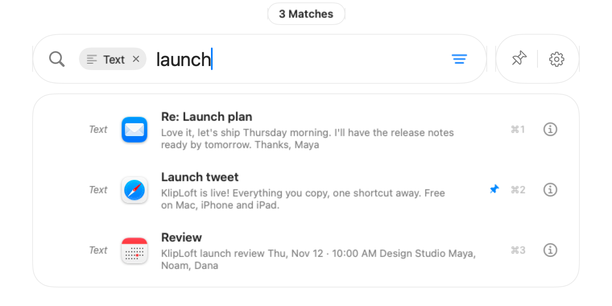
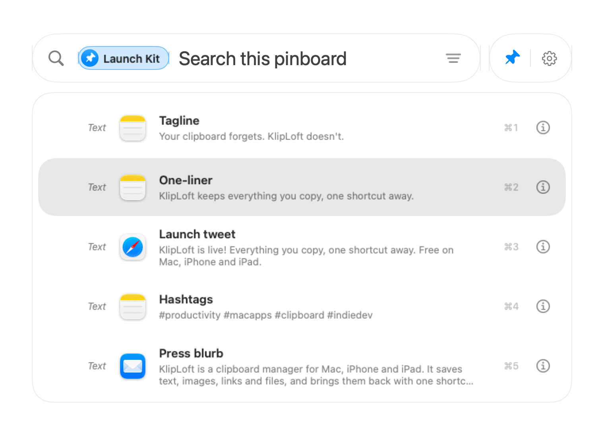
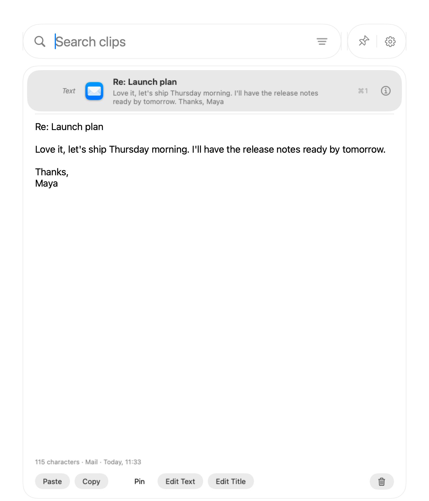
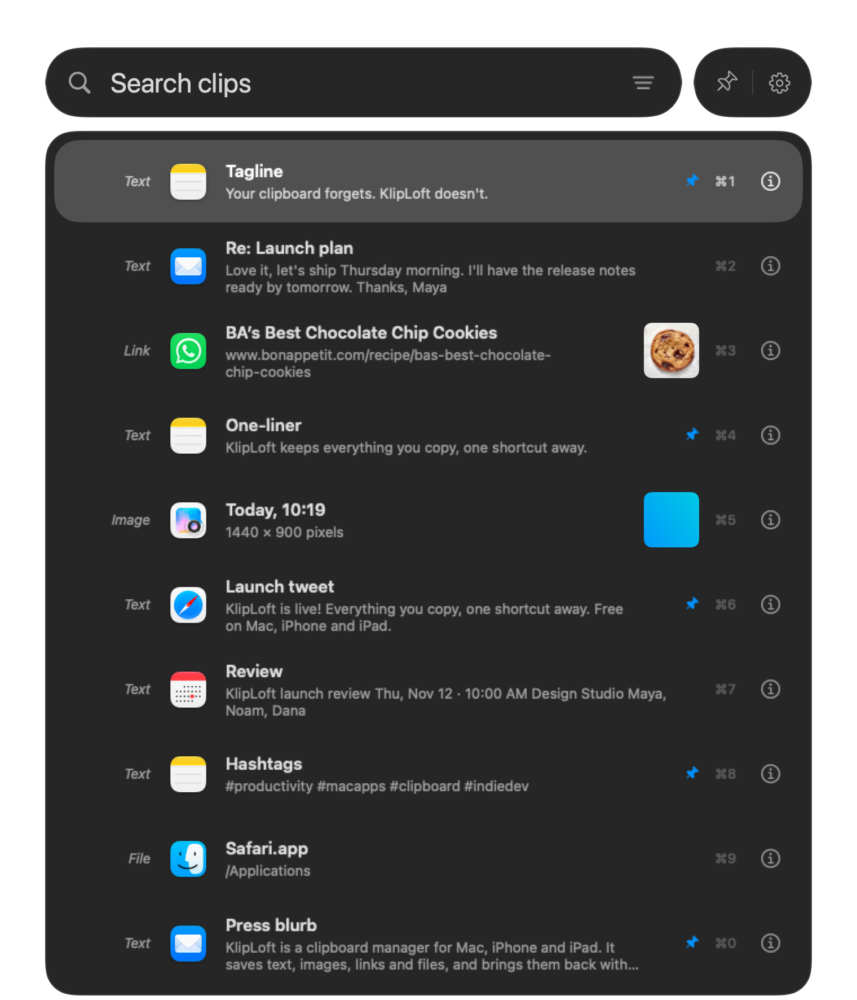

<div align="center">



# KlipLoft Mini

**Your clipboard history in one search bar.**

Press <kbd>⌥</kbd> <kbd>Space</kbd>, pick a clip, and it's pasted.<br>
Private and open source, from the maker of [KlipLoft](https://www.kliploft.app).

<a href="https://apps.apple.com/app/kliploft-mini/id6837203965?mt=12">
  <picture>
    <source media="(prefers-color-scheme: dark)" srcset="docs/assets/mac-app-store-white.svg">
    
  </picture>
</a>

**[🌐 Website](https://www.kliploft.app/mini) · [▶️ Watch the demo](https://youtu.be/Wa0ybQQhZHU) · [📺 All videos](https://www.youtube.com/@Klip-App)**

[](https://apps.apple.com/app/kliploft-mini/id6837203965?mt=12)
[](#build-from-source)
[](https://developer.apple.com/xcode/swiftui/)
[](LICENSE)
[](https://github.com/ronier83/KlipLoftMini/actions/workflows/build.yml)

<br>

<picture>
  <source media="(prefers-color-scheme: dark)" srcset="docs/assets/recent-dark.png">
  
</picture>

</div>

## See it in action

<div align="center">

<a href="https://youtu.be/Wa0ybQQhZHU"></a>

<sub>▶️ [Watch the demo on YouTube](https://youtu.be/Wa0ybQQhZHU) · more videos on the [KlipLoft channel](https://www.youtube.com/@Klip-App) · [kliploft.app/mini](https://www.kliploft.app/mini)</sub>

</div>

## Download

There are two ways to get KlipLoft Mini:

- **Mac App Store:** [get KlipLoft Mini on the Mac App Store](https://apps.apple.com/app/kliploft-mini/id6837203965?mt=12)
  for $4.99 once. It installs in one click, updates itself and syncs through iCloud.
- **Source:** [build it yourself](#build-from-source) for free in a couple of minutes. Pull the latest
  source and build again to update.

## Find it in your menu bar

Mini has no Dock icon. After you install it, look for the search bar icon in your menu bar. Press
<kbd>⌥</kbd> <kbd>Space</kbd> anywhere and your clips are right there, or click the icon to open Mini or its settings.

<div align="center">

<picture>
  <source media="(prefers-color-scheme: dark)" srcset="docs/assets/menubar-dark.svg">
  
</picture>

</div>

## Features

### One search away
- Your latest clips the moment you press <kbd>⌥</kbd> <kbd>Space</kbd>, and your whole history below them
- Search text, titles and keywords as you type, with a live count of the matches
- <kbd>⌘</kbd> <kbd>1</kbd> to <kbd>⌘</kbd> <kbd>0</kbd> paste any of the first ten clips in every list
- Arrow keys or the mouse, whichever you're using

### Filter by type or app
- Narrow results to text, links, images, files or colors
- Or to the app you copied from: Mail, Safari, Notes, Terminal…
- Filters sit in the search as chips; <kbd>Delete</kbd> removes them

### See it before you paste
- Press <kbd>Space</kbd> (or click ⓘ) to preview a clip right in the list
- Edit text right there before you paste it
- Links show their page's title and picture

### Pinboards
- Pin the snippets, replies and links you paste often
- Open your pinboards with the pin button or <kbd>Tab</kbd>, and paste in a keystroke

### Private
- Skips passwords from password managers, and optionally API keys and tokens
- Ignore any app you choose
- Deleted clips are wiped from disk, not just hidden
- No account, no tracking, no ads

### Fast and light
- Lives in the menu bar, with no Dock icon
- Opens instantly, even with 10,000 clips in your history
- Uses next to no energy while you work

## Screenshots

<table>
  <tr>
    <td align="center"><br><sub>Search with filter chips</sub></td>
    <td align="center"><br><sub>Pinboards</sub></td>
  </tr>
  <tr>
    <td align="center"><br><sub>Preview and edit before you paste</sub></td>
    <td align="center"><br><sub>Light and Dark Mode</sub></td>
  </tr>
</table>

## Mini or KlipLoft?

KlipLoft Mini is the quickest way in. When you want more, [KlipLoft](https://www.kliploft.app) is its bigger
sibling, and it's free. With the App Store version of Mini, your history and pinboards sync to
KlipLoft through your own iCloud, so they're already there when you switch.

| | KlipLoft Mini | KlipLoft |
|---|:---:|:---:|
| Clipboard history with search | ✓ | ✓ |
| Filters by type and app | ✓ | ✓ |
| Preview and edit before pasting | ✓ | ✓ |
| Pinboards | ✓ | ✓ |
| Skips passwords, wipes deleted clips | ✓ | ✓ |
| iCloud sync between your Macs | App Store version | ✓ |
| Your clips as a drawer of cards, in card styles | | ✓ |
| iPhone and iPad app, with a keyboard that pastes your clips | | ✓ |
| One-click import from Paste or Maccy | | ✓ |
| MCP server, so AI apps can read and build pinboards | | ✓ |
| Open source | ✓ | |

<div align="center">

<a href="https://www.kliploft.app"></a>

</div>

Settings › About in Mini has the same link.

## Privacy

Your clips never leave your Mac, except to your own private iCloud database when sync is on in the App
Store version (the developer can't read it). There are no analytics, crash reports, ads or accounts.

The one other connection is link previews: when you copy a link, Mini fetches that page's title and picture
directly from the site. You can turn this off in Settings › Clips.

Picking a clip copies it; you press <kbd>⌘</kbd> <kbd>V</kbd> to paste. Mini never asks for Accessibility
access.

## Build from source

You need a Mac with **macOS 26** and **Xcode 26** or later.

```sh
git clone https://github.com/ronier83/KlipLoftMini.git
cd KlipLoftMini
open KlipLoftMini.xcodeproj
```

Then choose **Product › Run** (<kbd>⌘</kbd> <kbd>R</kbd>).

To sign with your own Apple developer team, copy the example config and fill it in. Your copy is git-ignored.

```sh
cp Config/Local.example.xcconfig Config/Local.xcconfig
```

Or build from the command line without signing:

```sh
xcodebuild -project KlipLoftMini.xcodeproj -scheme KlipLoftMini -configuration Release \
  -derivedDataPath build CODE_SIGNING_ALLOWED=NO build
```

Builds from source keep their history on your Mac. iCloud sync needs KlipLoft's iCloud container, which only
the official App Store version can use, so Mini detects this and hides the iCloud setting.

## Contributing

Bug reports, ideas and pull requests are welcome. Please read [CONTRIBUTING.md](CONTRIBUTING.md) first, and
report security issues privately as described in [SECURITY.md](SECURITY.md).

## License

KlipLoft Mini's source code is free software under the [GNU General Public License v3.0](LICENSE).
© 2026 Ron Erez.

The KlipLoft and KlipLoft Mini names and icons are trademarks and aren't covered by the GPL-3.0. If you
publish a fork, give it its own name and icons. See [TRADEMARKS.md](TRADEMARKS.md).
